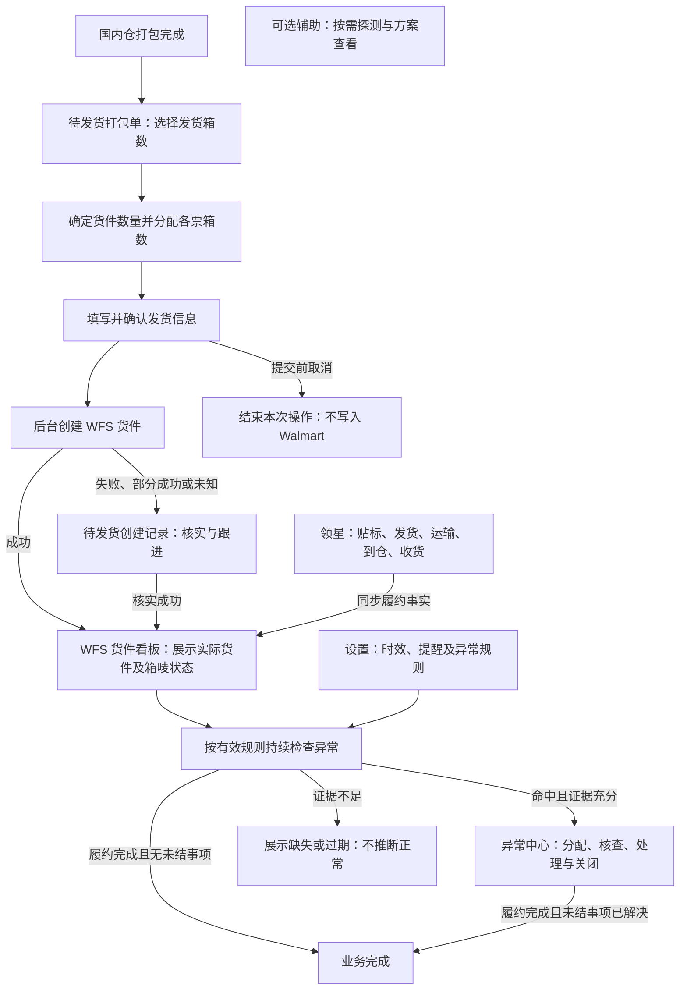

# WFS 四 Tab 开发需求总览

版本：V2.0 配套开发需求评审稿｜日期：2026-10-29｜主执行角色：后端工程师。

本次交付是四个页面的开发需求及验收依据，不是功能实现或已批准 PRP。所有新增接口、权限、数据实体、状态和任务设计均为待评审契约；代码现状仅代表分析时工作区内容，不代表已合并或验收。

## 1 文档入口

| 页面 | 开发需求 | 核心交付 |
|---|---|---|
| 待发货打包单 | [01-待发货打包单开发需求](01-待发货打包单开发需求.md) | 按箱数分配、确认创建、幂等与未知结果恢复、箱唛获取 |
| WFS 货件看板 | [02-WFS货件看板开发需求](02-WFS货件看板开发需求.md) | 实际货件、箱唛状态、领星履约进度、同步状态 |
| 异常中心 | [03-异常中心开发需求](03-异常中心开发需求.md) | 有证据的异常识别、分配、处理、申诉跟进和关闭 |
| 设置 | [04-设置开发需求](04-设置开发需求.md) | 规则及默认值持久化、版本、生效范围、影响预览和审计 |

每份文档包括代码证据、功能范围、字段与交互、后端规则、数据来源、接口能力、权限、验收场景、实施切片及待确认事项。

产品依据：[WFS 业务产品需求文档 V2.0](C:/Users/treas/.codex/visualizations/2026/10/28/01a1809e-b84b-7141-88d9-14e62f2fe23b/WFS业务产品需求文档V2.0.md)、[业务主流程 V2.0](C:/Users/treas/.codex/visualizations/2026/10/28/01a1809e-b84b-7141-88d9-14e62f2fe23b/WFS业务主流程V2.0.png)。这些为当前机器上的源文件路径，其他开发环境应取得相同版本副本。

## 2 已确定的业务边界

- 仅保留四个 Tab；系统货件写入、探测列表、创建看板不再作为独立 Tab。必要的后台执行与恢复能力仍保留。
- 用户选择发货箱数、拆成几个货件、各货件分配多少箱。装箱明细用于核对与后台准确分箱，不是原有勾选装箱行的主流程。
- 分仓探测按需使用，位于主流程之外；不探测仍可确认创建。
- 填写并确认信息后进入创建，无提交审批、批准或驳回。提交前取消不调用 Walmart 创建；提交后结果未知必须核实，不能按未创建处理。
- 核对贴标、实际发货及运输、到仓、收货执行在领星。本系统展示从领星取得的履约信息，不增加第二套履约操作。
- 配置治理、后端权限和审计不因取消货件创建审批而取消。

## 3 主流程及页面衔接

图中“结束本次操作”不等于货件履约完成；探测是独立辅助入口。箱唛获取失败不撤销已创建事实；部分成功时成功货件即可进入看板，其余票继续跟进。异常检查贯穿可用节点，不仅在收货之后运行。

| 衔接 | 必须统一的契约 |
|---|---|
| 国内仓 → 待发货 | 稳定单据及箱身份、装箱版本、数量、店铺/账号、可用和占用口径 |
| 待发货 → 看板 | 创建操作与各票结果、实际外部货件 ID、来源版本、箱分配、箱唛状态；不得靠名称模糊关联 |
| 领星 → 看板 | 货件映射、节点时间及精度、实收数量、来源时间、同步新鲜度；缺失值与零区分 |
| 看板 → 异常 | 同一货件事实、数据截至时间、缺失字段、稳定事件标识；详情及统计权限一致 |
| 设置 → 异常 | 规则版本、生效范围、起算依据、单位、阈值；历史案件保留命中证据 |
| 全部页面 | 同一账号/店铺权限、测试数据标识、时间口径、请求关联、帮助入口和审计 |

## 4 当前代码与目标的关键差距

旧代码入口为 `old-walmar-flie/features/pmc-wfs-shipment/drafts/src/`。`app-e.jsx`、`app-b.jsx` 的装箱和拆票逻辑可用于理解业务，但包含模拟执行及旧审批路径；`app-a.jsx` 的异常推算存在演示阈值与补日期逻辑；`app-d.jsx` 的设置有本地状态和规则标识/单位问题。不能照搬为生产逻辑。

新系统 `backend/app/modules/pmc_wfs/` 已有待发货查询、草稿及权限基础。观察到的草稿输入仍以 `box_line_ids` 为主，且返回 `execution_enabled=false`，与按箱数分配、真实创建并恢复结果仍有差距。前端 WFS 支撑页部分为本地状态或演示数据；不能因页面可见就判定后端完成。现有 `warehouse_wfs` 费用异常业务不自动等同本次货件异常中心。

这些是工作区分析结论；实施前应对最终批准基线复核，不覆盖其他人的在途改动。

## 5 开发前的数据源决策

须逐项填写项目《接口数据源决策》，先于接口 PRP。本总览不代替正式决策文件。

| 数据域 | 拟采用方向 | 实施前需要证据或负责人决定 |
|---|---|---|
| 国内仓打包与箱子 | 新系统自有事实 | 上游接口/表责任、箱身份、尾箱与混箱、跨 PK 规则 |
| 创建与箱唛 | 经批准的 Walmart 集成 | 当前官方接口契约、店铺授权、箱数限制、幂等/回查能力、地址含义 |
| 履约进度 | 领星同步进入新系统 | 确切接口或数据集、账号范围、字段映射、稳定关联、刷新频率、历史回补 |
| 案件与处理记录 | 新系统自有业务记录 | 异常类型、负责人选择范围、关闭与重开规则、申诉证据来源 |
| 规则和默认值 | 新系统版本化配置 | 初始有效值、优先级、生效时点、审批范围与历史重算边界 |
| 旧系统历史数据 | 逐数据集决定归档或迁移 | 真实性、数据质量、脱敏样例、迁移授权；禁止运行时直连兜底 |

当前未核验真实 Walmart/领星接口，不宣称其具备某项特定操作能力。无可信数据来源或存在争议时记录 NEED_OWNER_DECISION，阻塞相应接口实现；不以模拟值补足业务事实。

## 6 实施与验收顺序

1. 确认四份需求的业务边界及待定项，完成接口数据源决策。
2. 按一个页面或一个 API 模块拆任务，形成 INITIAL_FEATURE 与 PRP，由负责人确认；不将四份文档视为一次性开发授权。
3. 优先明确箱分配和货件身份契约，再实现待发货查询/分配、受控创建及恢复。看板查询可基于已确认事实来源独立推进。
4. 设置规则契约与异常事件契约协调后，分别实现持久化、计算和处理闭环。复用现有任务基础设施，不自行修改公共调度与 CI。
5. 按各文档验收表完成权限、并发、幂等、未知结果、空数据、同步失败、版本冲突和页面 E2E；补齐 API 文档、SOP、registry、交接与回滚说明。

本次只新增本目录五份文档，依用户要求保留当前分支；未实施接口、页面、迁移、部署或生产操作。后续实现的分支、PR 与审批方式按届时授权和项目规范处理。

## 7 项目规范入口

- `AGENTS.md`、`AI_DAILY_RULES.md`
- `docs/delivery/backend-data-source-decision-gate.md`
- `docs/data-sources/database-layering-standard.md`
- `docs/data-sources/field-standardization-standard.md`
- `docs/ui/ADMIN_LAYOUT_RULES.md`、`docs/ui/UI_COMPONENT_USAGE_RULES.md`
- `docs/DATA_INTERFACE_REGISTRY_RULES.md`、`docs/DEFINITION_OF_DONE_RULES.md`
- `docs/READ_WRITE_PERMISSION_BOUNDARY_RULES.md`、`docs/VALIDATION_AND_TESTING_RULES.md`

如后续项目规范或批准的数据源决策与候选技术方案不一致，应更新需求契约并重新评审受影响部分。
